# AI-Powered Interview Evaluation & Resume Analysis System

**Project Phase II Presentation** — Department of Information Science and Engineering

> Viewable Markdown export of `Project_Report_PPT.pptx` (~20 slides). Images use relative paths so Cursor can preview them.

---

## Slide 1: AI-Powered Interview Evaluation & Resume Analysis System

*Project Phase II Presentation*

*Department of Information Science and Engineering*

*Project Associates  •  Under the Guidance of Project Guide*

*Program Coordinator: Dr. Vinutha H P*

*Project Coordinators: Dr. Arun Kumar G H, Prof. Santhosh T*

---

## Slide 2: Contents

- Abstract
- Introduction & Problem Statement
- Objectives
- Existing vs Proposed System
- System Architecture
- System Modules
- Candidate Workflow
- Technology Stack
- Scoring Model
- Use Case / Data Flow
- Screenshots (Home, Login, Verification)
- Testing
- Results & Advantages
- Conclusion & Future Work
- References / Thank You

---

## Slide 3: Abstract

This project is an AI-powered recruitment support system that helps reduce recruiter workload by automating resume screening, interview assessment, and final candidate evaluation.

It extracts skill, education, and experience details from resumes, compares them with job requirements, and calculates a job-match score. Identity verification uses ID upload and face matching. A structured interview includes MCQ, theory, and coding questions.

The final output is a generated report that helps recruiters make faster, fairer, and more informed decisions.

---

## Slide 4: Introduction

- Makes hiring smarter by combining resume analysis, verification, and interview evaluation
- Many companies still rely on manual screening — slow and sometimes biased
- Uses AI-based logic and structured evaluation to improve speed and reliability
- Supports multiple job roles and generates role-based interview questions
- Provides clear scores and recommendations for decision-making
- Suitable for companies, recruitment teams, and academic assessment systems

---

## Slide 5: Problem Statement

The recruitment process is often slow, inconsistent, and manual. Recruiters must read large numbers of resumes, compare candidate skills with job requirements, and evaluate technical ability through interviews.

In many cases this makes the process inefficient and unfair. There is also a risk of fake candidates attempting to attend interviews without proper identity verification.

This project addresses these issues by building an AI-powered system that automates resume analysis, candidate verification, interview evaluation, and report generation.

---

## Slide 6: Objectives

- Design an intelligent system for candidate resume analysis
- Extract skills, education, and experience from resumes automatically
- Match candidate profiles with the required job description
- Verify candidate identity using ID upload and selfie comparison
- Generate role-based interview questions and evaluate responses
- Produce fair and structured candidate reports for recruiters
- Improve the speed, efficiency, and reliability of recruitment

---

## Slide 7: Existing System vs Proposed System

- Existing: manual screening, inconsistent scoring, weak identity checks
- Proposed: auto parsing, structured scoring, ID+face verify, dashboard reports

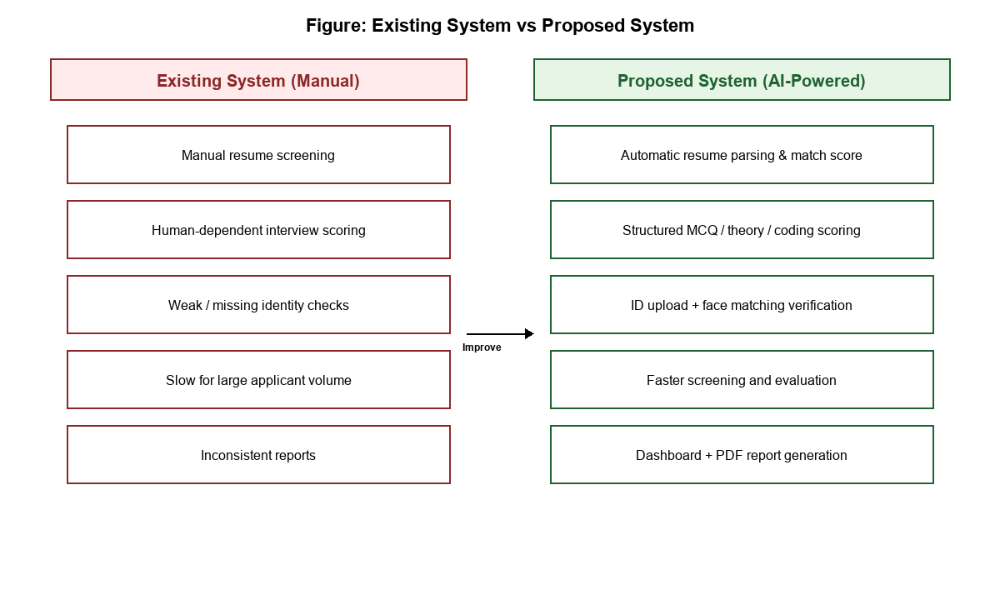

`hand_drawn_diagrams/existing_vs_proposed.png`

---

## Slide 8: System Architecture

- Presentation layer: React.js
- API layer: FastAPI
- Business logic + AI engine
- Data layer: SQLite / SQLAlchemy

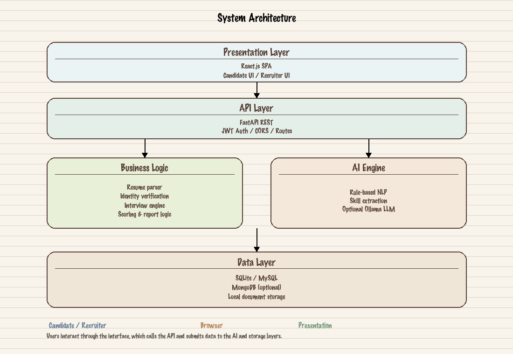

`hand_drawn_diagrams/architecture_diagram.png`

---

## Slide 9: System Modules

- User module
- Resume analysis module
- Verification module
- Interview module
- Scoring module
- Reporting module

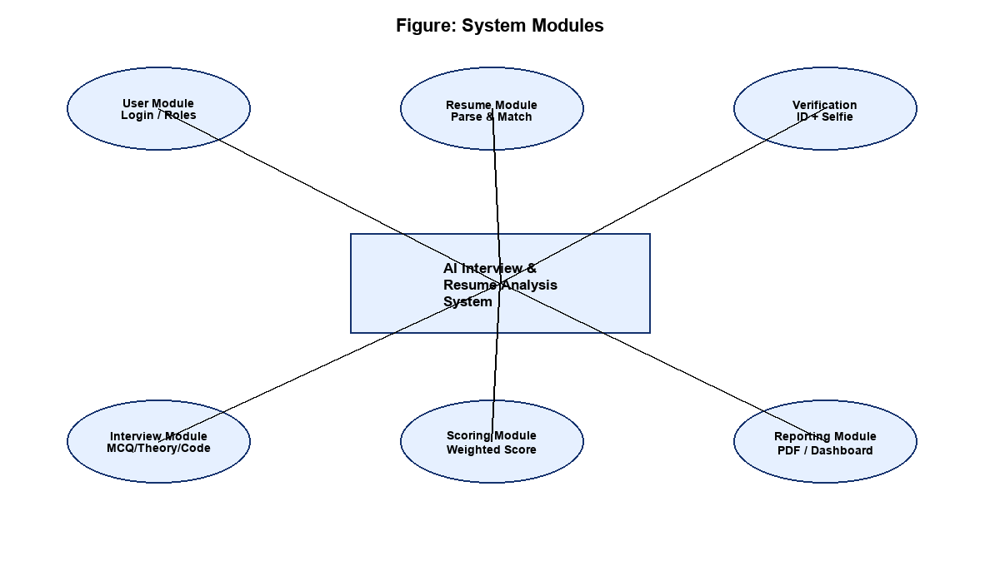

`hand_drawn_diagrams/system_modules.png`

---

## Slide 10: Candidate Workflow

- Login → Upload Resume → Identity Verification → Interview → Score & Report

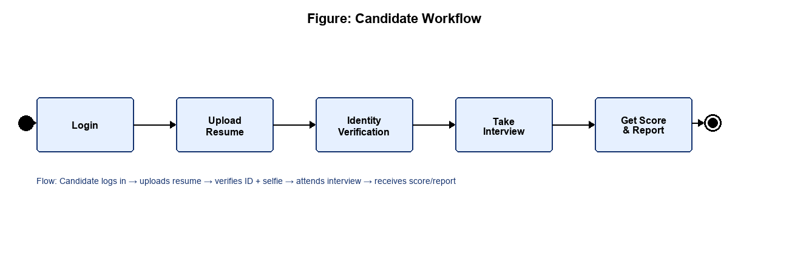

`hand_drawn_diagrams/candidate_workflow.png`

---

## Slide 11: Technology Stack

- Frontend: React.js
- Backend: FastAPI
- Database: SQLite / SQLAlchemy
- AI/NLP: rule-based (+ optional Ollama)
- Tools: VS Code, Git, Postman

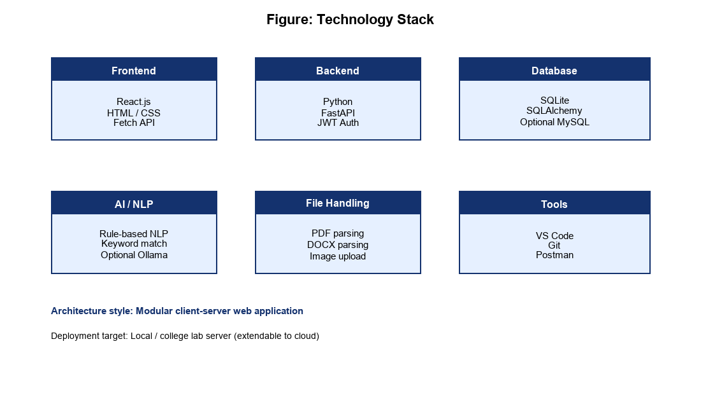

`hand_drawn_diagrams/tech_stack.png`

---

## Slide 12: Scoring Model

- Resume match: 30%
- MCQ: 25%
- Theory: 25%
- Coding: 20%
- Output: Final score (0–100) + recommendation

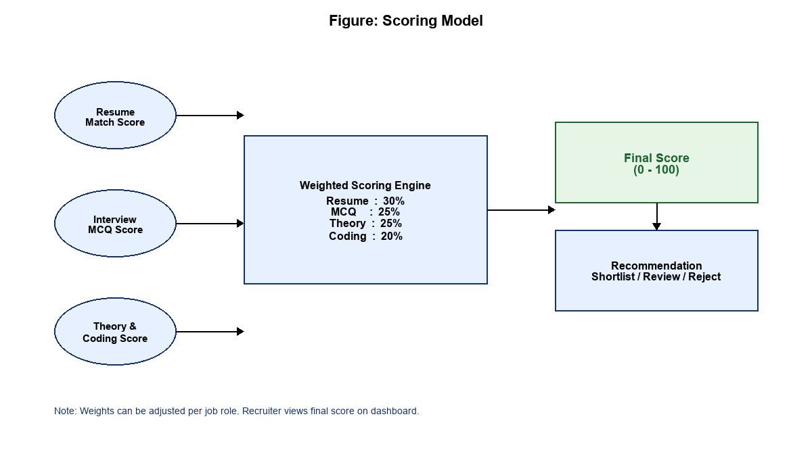

`hand_drawn_diagrams/scoring_model.png`

---

## Slide 13: Use Case / Data Flow

- Actors: Candidate, Recruiter
- Core use cases: login, upload resume, verify identity, interview, report

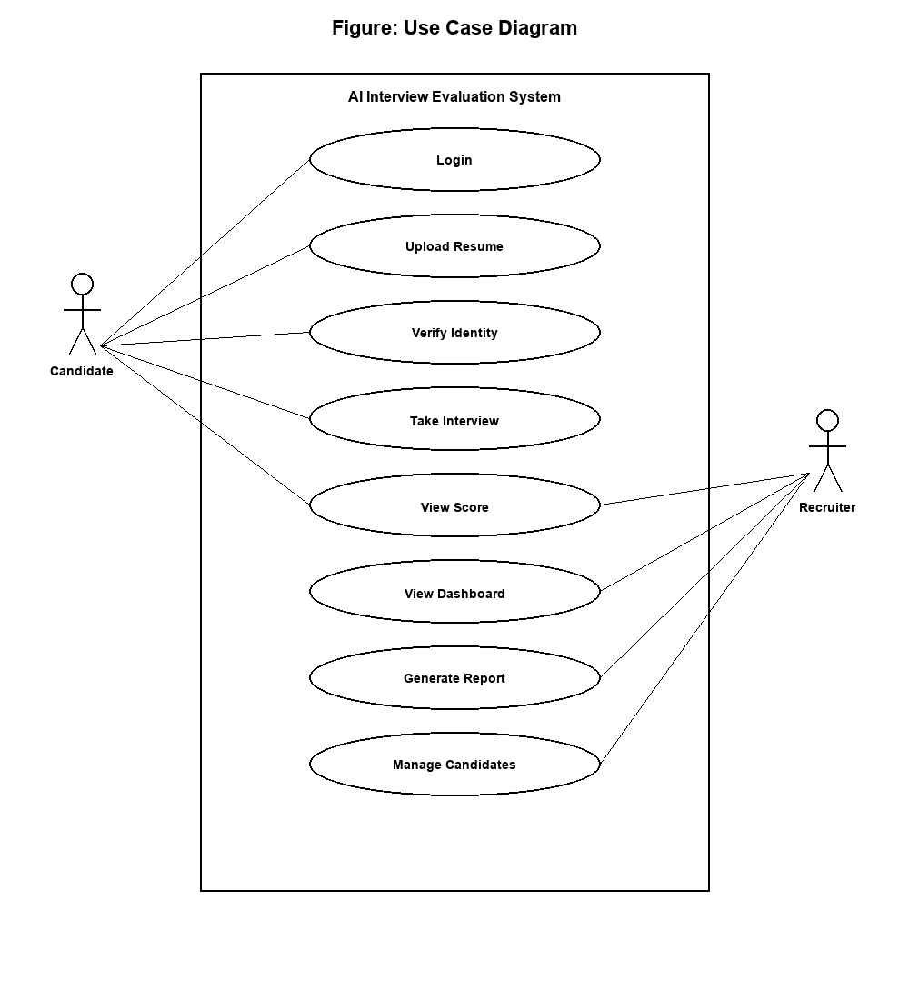

`hand_drawn_diagrams/use_case_diagram.png`

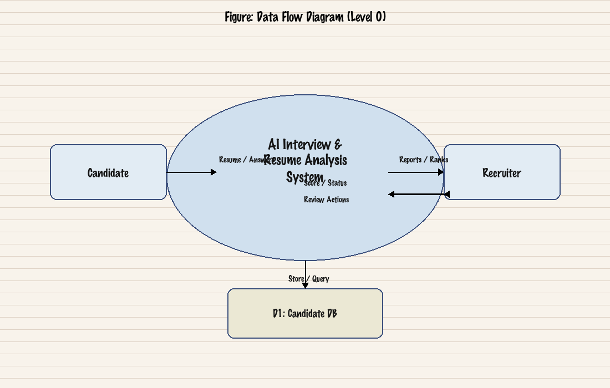

`hand_drawn_diagrams/data_flow_diagram.png`

---

## Slide 14: Screenshot: Home Page

- Landing page with navigation to Identity Check and Resume Analysis

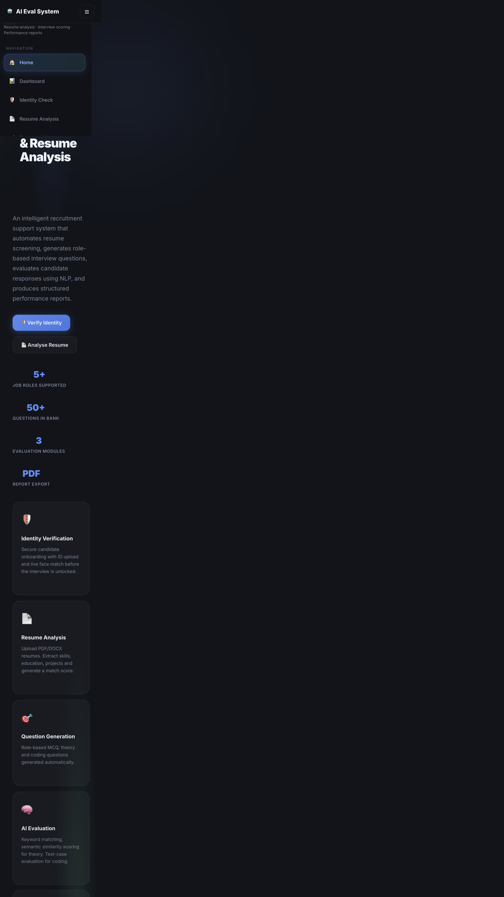

`project_images/home.png`

---

## Slide 15: Screenshot: Candidate Login

- Role-based login for candidates (demo credentials supported)

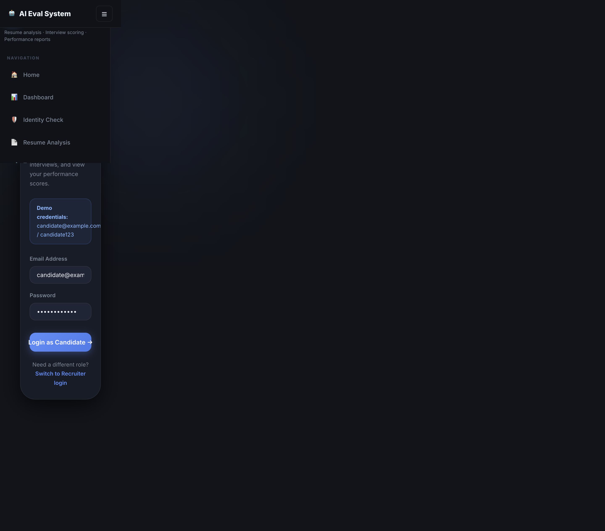

`project_images/candidate_login.png`

---

## Slide 16: Screenshot: Identity Verification

- Steps: ID upload → Selfie capture → Access unlock

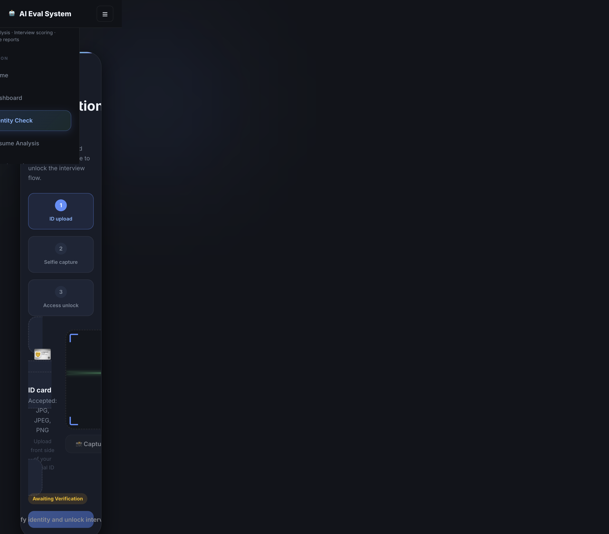

`project_images/verification.png`

---

## Slide 17: Testing

### Testing Strategies

- Unit Testing – parsing, scoring, validation
- Integration Testing – frontend, backend, DB
- System Testing – full login-to-report flow
- Acceptance Testing – meets project requirements

### Sample Test Cases (Pass)

- TC01 Valid candidate login
- TC03 Resume upload
- TC05 Identity verification pass
- TC07 Interview generation
- TC08 Score calculation
- TC09 Report PDF generation

*Tools: Manual testing, browser testing, Postman*

---

## Slide 18: Results & Advantages

### Results

- Resume details extracted with job-match score
- Identity verification blocks invalid attempts
- Role-based MCQ, theory, coding evaluation works
- Dashboard shows rankings and summary metrics
- PDF reports generated for recruiters

### Advantages

- Saves time in screening
- Improves evaluation consistency
- Adds identity security layer
- Supports role-based assessments
- Enables better candidate comparison

*Limitations: complex answer scoring and resume formatting edge cases*

---

## Slide 19: Conclusion & Future Enhancements

Conclusion: The project successfully demonstrates how AI can improve recruitment by combining resume analysis, identity verification, role-based interview evaluation, and report generation into one practical system. It reduces manual effort and helps recruiters make better decisions.

### Future Enhancements

- Voice / video interview analysis and stronger biometric verification
- Advanced LLM-based scoring and multilingual interfaces
- Cloud hosting, recruiter notifications, and mobile support

---

## Slide 20: Thank You…!

*Questions & Discussion*

*References (selected): Smart recruitment / resume NLP literature (2020–2024); FastAPI, React, SQLAlchemy documentation; project open-source libraries used for parsing and evaluation.*

---
